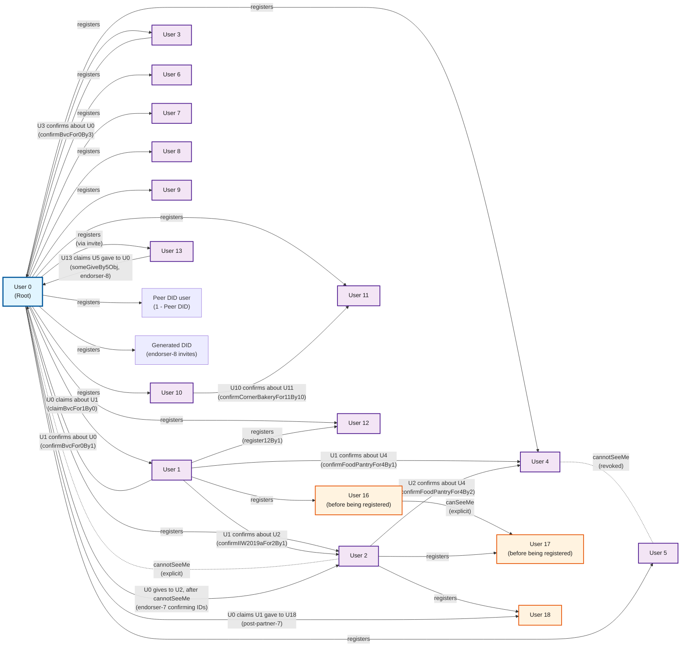
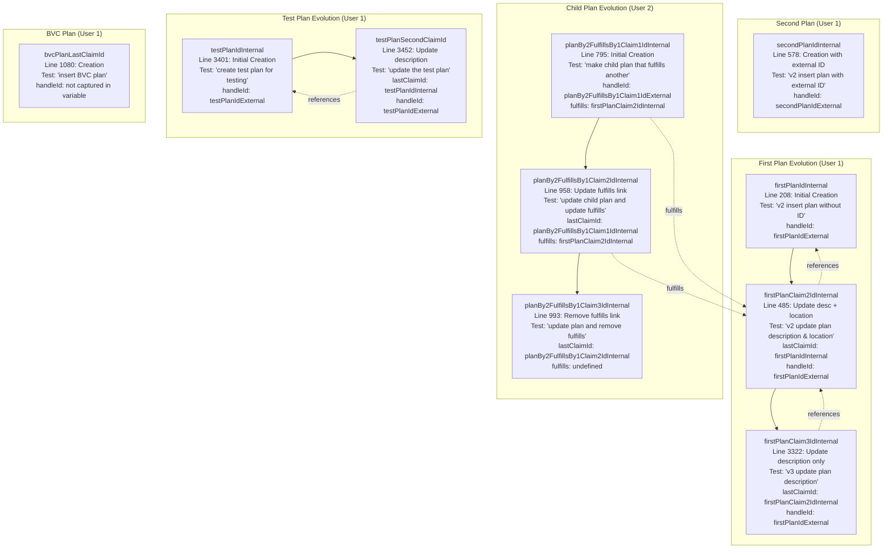

# Test Documentation

This folder contains comprehensive tests for the Endorser API, with detailed scenarios for plan management, JWT claims, change detection functionality, and AI-powered profile matching.

---

## Registration Tree

```mermaid
graph TD
    U0["User 0<br/>0x000...<br/>(Root)"]
    
    U0 --> U1["User 1<br/>0x111..."]
    U0 --> U2["User 2<br/>0x222..."]
    U0 --> U3["User 3<br/>0x333..."]
    U0 --> U4["User 4<br/>0x444..."]
    U0 --> U5["User 5<br/>0x555..."]
    U0 --> U6["User 6<br/>0x666..."]
    U0 --> U7["User 7<br/>0x777..."]
    U0 --> U8["User 8<br/>0x888..."]
    U0 --> U9["User 9<br/>0x999..."]
    U0 --> U10["User 10<br/>0xAAA..."]
    U0 --> U11["User 11<br/>0xBBB..."]
    U0 --> U12["User 12<br/>0xCCC..."]
    U0 --> U13["User 13<br/>0xDDD..."]
    U14["User 14<br/>0xEEE...<br/>(never registered)"]
    U15["User 15<br/>0xFFF...<br/>(never registered)"]
    
    U1 --> U16["User 16<br/>0xaaa..."]
    U2 --> U17["User 17<br/>0xbbb..."]
    U2 --> U18["User 18<br/>0xccc..."]
    
    style U0 fill:#e1f5ff,stroke:#01579b,stroke-width:3px,color:#1a1a1a
    style U1 fill:#f3e5f5,stroke:#4a148c,stroke-width:2px,color:#1a1a1a
    style U2 fill:#f3e5f5,stroke:#4a148c,stroke-width:2px,color:#1a1a1a
    style U3 fill:#f3e5f5,stroke:#4a148c,stroke-width:2px,color:#1a1a1a
    style U4 fill:#f3e5f5,stroke:#4a148c,stroke-width:2px,color:#1a1a1a
    style U5 fill:#f3e5f5,stroke:#4a148c,stroke-width:2px,color:#1a1a1a
    style U6 fill:#f3e5f5,stroke:#4a148c,stroke-width:2px,color:#1a1a1a
    style U7 fill:#f3e5f5,stroke:#4a148c,stroke-width:2px,color:#1a1a1a
    style U8 fill:#f3e5f5,stroke:#4a148c,stroke-width:2px,color:#1a1a1a
    style U9 fill:#f3e5f5,stroke:#4a148c,stroke-width:2px,color:#1a1a1a
    style U10 fill:#f3e5f5,stroke:#4a148c,stroke-width:2px,color:#1a1a1a
    style U11 fill:#f3e5f5,stroke:#4a148c,stroke-width:2px,color:#1a1a1a
    style U12 fill:#f3e5f5,stroke:#4a148c,stroke-width:2px,color:#1a1a1a
    style U13 fill:#f3e5f5,stroke:#4a148c,stroke-width:2px,color:#1a1a1a
    style U14 fill:#eeeeee,stroke:#757575,stroke-width:2px,stroke-dasharray:4,color:#1a1a1a
    style U15 fill:#eeeeee,stroke:#757575,stroke-width:2px,stroke-dasharray:4,color:#1a1a1a
    style U16 fill:#fff3e0,stroke:#e65100,stroke-width:2px,color:#1a1a1a
    style U17 fill:#fff3e0,stroke:#e65100,stroke-width:2px,color:#1a1a1a
    style U18 fill:#fff3e0,stroke:#e65100,stroke-width:2px,color:#1a1a1a
    style PEER fill:#eeeeee,stroke:#757575,stroke-width:2px,color:#1a1a1a
    style NEW fill:#eeeeee,stroke:#757575,stroke-width:2px,color:#1a1a1a
```



**Legend:**
- **User 0** (blue): Root user who registered all other users
- **Users 1-13** (purple): All registered directly by User 0
  - Users 1-4 and 10-12 in `controller-endorser-1-basics.js`, users 5-9 in `controller-endorser-2-basics-2.js`
  - User 13 by redeeming User 0's invite in `controller-endorser-8-invites.js` (direct registrations of 13 are rejected in `controller-endorser-5-register-limits.js`)
  - User 1 also submits a registration of User 12 in `controller-endorser-5-register-limits.js`; it is accepted as a claim, but the registration row keeps User 0 as registrar
- **Users 14-15** (gray): Never registered; used as unregistered users
- **Users 16-18** (orange): Second-level users registered in "Deeper Tree" tests
  - User 16 registered by User 1
  - Users 17 & 18 registered by User 2
- **Arrows**: Show registration direction (registrar → registered user)

**Registration Details:**
- User 0 is the root of the registration tree via SQL for "maxRegs: 17" in `controller-endorser-0-setup.js`
- Later updates are via `registrationUpdateMaxClaimsForTests`
- The "Deeper Tree" registrations in `controller-partner-5-nearest-neighbor.js` create a multi-level tree for testing cousin relationships and deeper path traversal


## Visibility Graph

This graph shows selected "can see" relationships established in the test suite (but it is not comprehensive outside User 0). There are two ways visibility is granted:

1. **Explicit visibility via `canSeeMe` or hiding via `cannotSeeMe` endpoints**: A user explicitly allows another user to see or not see them
2. **Implicit visibility via claims**: When an issuer makes a claim about someone else, that person can see the issuer



**Legend:**
- **Solid arrows (→)**: Active "can see" relationships
  - **"registers"**: A registration is a claim about the registered user, so the registered user can see the registrar
  - **"canSeeMe (explicit)"**: User explicitly granted visibility via `/api/claim/canSeeMe` endpoint
  - **"claim about X"**: Issuer made a claim about another user, granting that user visibility to the issuer
- **Dashed lines (-.-)**: Revoked or blocked visibility
  - **"cannotSeeMe"**: User explicitly blocked visibility via `/api/claim/cannotSeeMe` endpoint
- **Arrow direction**: Points from the visible user to the viewer (e.g., `U4 → U5` means User 5 can see User 4)
- **Coverage**: Edges touching User 0 are complete, matching the `network` table after a full test run plus the one `cannotSeeMe` that User 0 issues. Edges between other users are a selection.

**Key Test Scenarios** (all in `controller-endorser-1-basics.js`):
1. **Implicit visibility through claims** (`1 - Claim`):
   - Test: `#0 should now see DID #1 as a side-effect of the claim by #1 that includes #0`
2. **Explicit visibility toggle** (`1 - Visibility utils`):
   - Tests from `#5 should not see #4` through `#5 should not get claims searching for #4`
3. **Explicit invisibility** (`1 - Visibility utils`):
   - Test: `#0 should set invisible to #2`
4. **Unregistered users** (`1 - Visibility utils`):
   - Shows that the visibility system works without registration
   - Test: `unregistered #16 should set visible to unregistered #17`
   - Users 16 and 17 are unregistered when this test runs; `registerBy0JwtEncs` only covers users 0-15. They are registered afterward in `controller-partner-5-nearest-neighbor.js` (see the Registration Tree), so by the end of the suite they are registered users.
5. **Claim-based visibility chains** (`1 - Transitive Connections`):
   - Creates transitive visibility paths through the network


---

## Controller Endorser 6 Tests

The `controller-endorser-6-plans-totals.js` test file creates a sequence of plan JWTs that evolve over time, providing rich test data for validating the `plansLastUpdatedBetween` endpoint and related functionality.

### Timeline Overview

```mermaid
gantt
    title Plan-Creation Timeline in Test 6
    dateFormat X
    axisFormat %s
    
    section First Plan (User 1)
    Created firstPlanIdInternal             :milestone, m1, 1, 0d
    Updated firstPlanClaim2IdInternal       :milestone, m2, 3, 0d  
    Edited firstPlanClaim3IdInternal        :milestone, m3, 21, 0d

    section Second Plan (User 1)
    Created secondPlanIdInternal            :milestone, m4, 5, 0d

    section Child Plan (User 2)
    Created planBy2...Claim1IdInternal      :milestone, m5, 7, 0d
    Updated fulfills planBy2...Claim2IdInternal  :milestone, m6, 9, 0d
    Removed fulfills planBy2...Claim3IdInternal  :milestone, m7, 11, 0d

    section BVC Plan (User 1)
    Created bvcPlanLastClaimId              :milestone, m8, 13, 0d

    section Test Plan (User 1)
    Created testPlanIdInternal              :milestone, m9, 23, 0d
    Updated testPlanSecondClaimId           :milestone, m10, 25, 0d
```



### Detailed JWT Evolution Graph



---

## Profile Matching Tests

- `controller-partner-3-group-matching-funs.js` checks the vector math and the meeting pairing algorithm against stored vectors of 28 test profiles in `embedding-eval/test-vectors.json`, so it needs no model.
- `controller-partner-8-embedding-engine.js` checks the embedding engine against golden vectors.
- `controller-partner-9-similar.js` checks the embedding sweep, `/api/partner/similar`, and the vector export endpoints.

The last two (and the profile saves in the other partner tests) load the embedding model, which downloads on first use (see the main README).

After changing the test profiles or the default embedding spec, regenerate the stored vectors, and optionally view them:

```bash
npm run embedding:test-vectors
npm run embedding:visualize   # writes embedding-eval/similarities.html
```

See `embedding-eval/README.md` for the evaluation corpus and tools.
